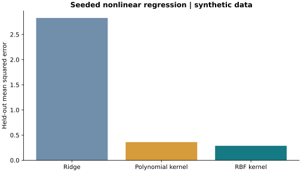

# Statistical Learning Lab

**When does regularization help, and when does nonlinear structure matter?**

A compact collection of ridge, polynomial-kernel and RBF-kernel experiments,
with a reproducible synthetic comparison and an archived coursework notebook.



## Methods

- Compare OLS with validation-selected ridge regression across seeded datasets.
- Study regularization paths and training-size effects.
- Compare linear and nonlinear kernels on a held-out sample.
- Fit scaling inside each cross-validation fold with a scikit-learn Pipeline.

## Reproduce the public experiment

```bash
pip install -r requirements.txt
python examples/compare_regressors.py
```

The example generates its own nonlinear regression data, searches model
hyperparameters on training folds and evaluates once on a held-out set. The
result is a controlled illustration, not a general model ranking or external
benchmark. Results and the figure are saved under `figures/`.

## Source notebook

`notebooks/ridge_and_kernel_experiments.ipynb` preserves the original experiments.
Its real-data sections need separately supplied `train.csv` and `test.csv` with
21 features and a final target column. Those files are not redistributed.
The archival learning-curve section scales before its CV search; the new public
example uses fold-local preprocessing to avoid that leakage pattern.

See [VALIDATION.md](VALIDATION.md) and [PROVENANCE.md](PROVENANCE.md).
